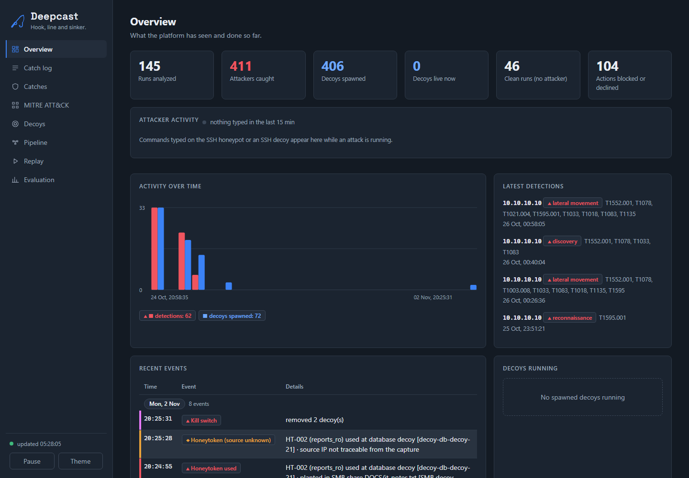
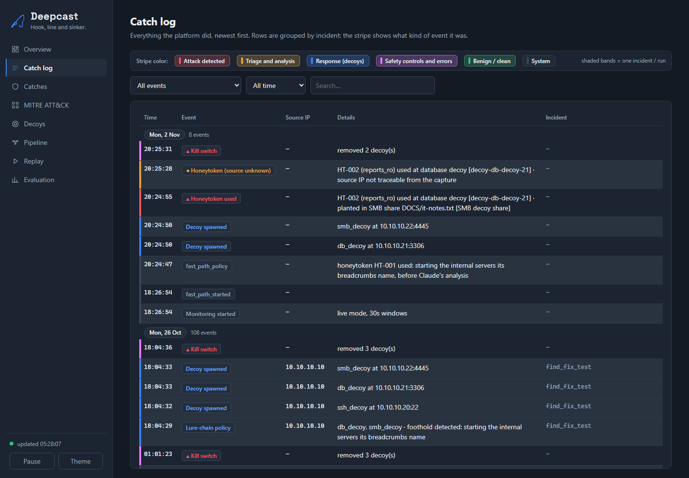
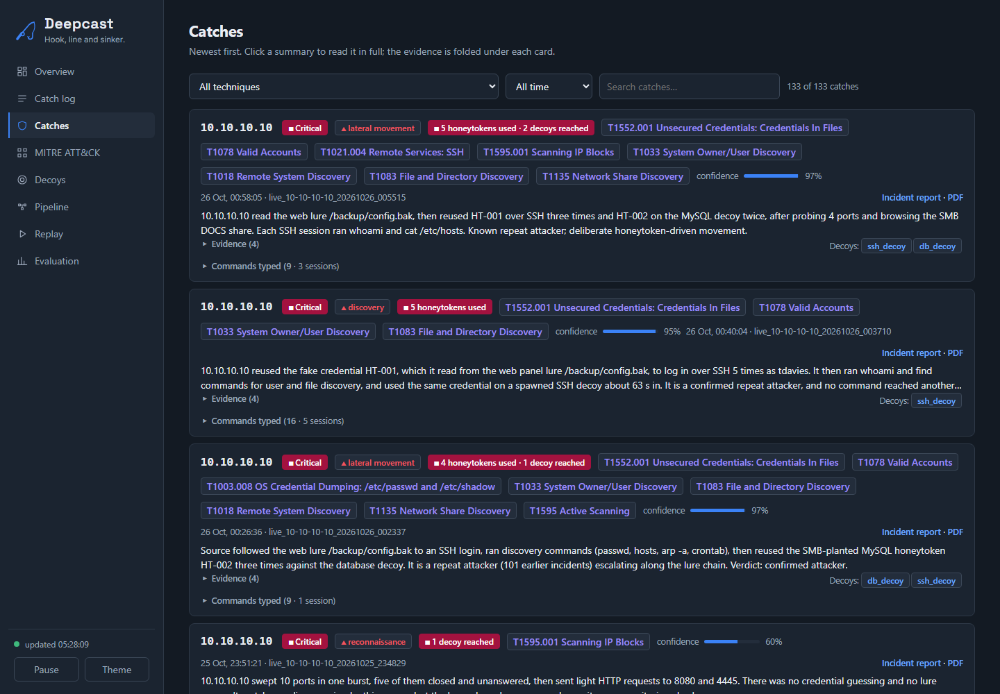
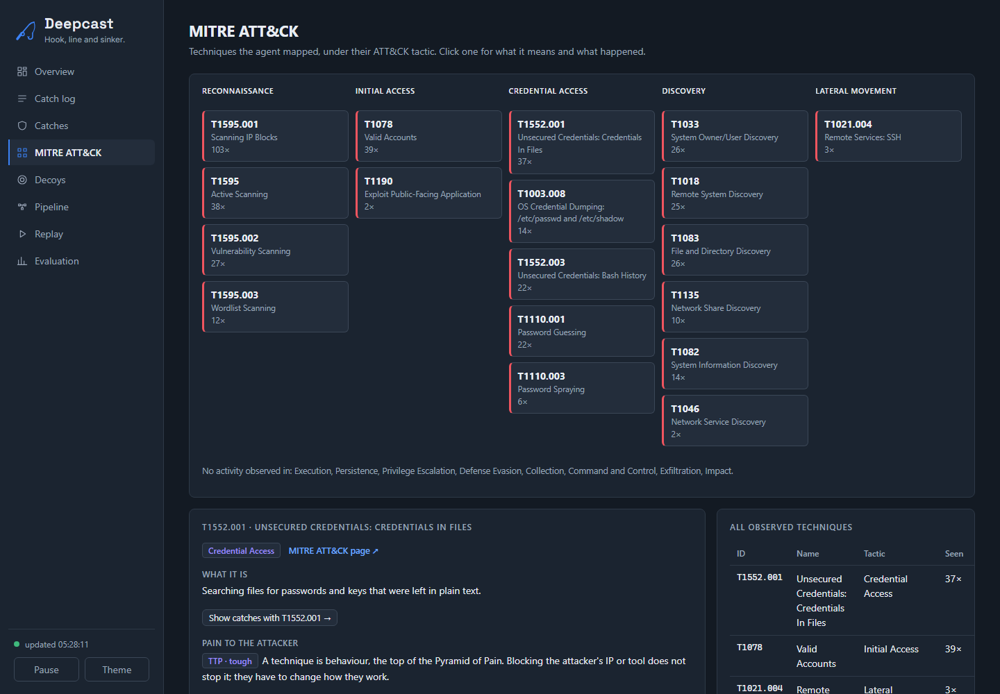
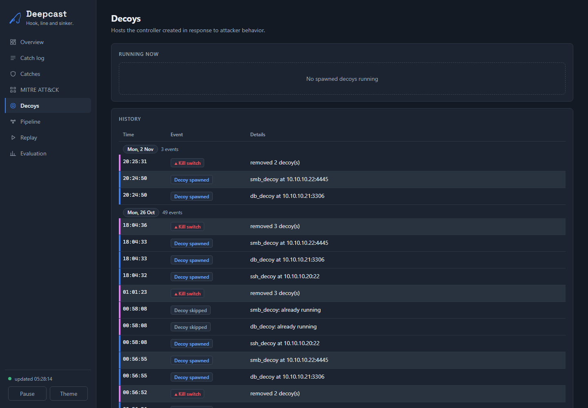
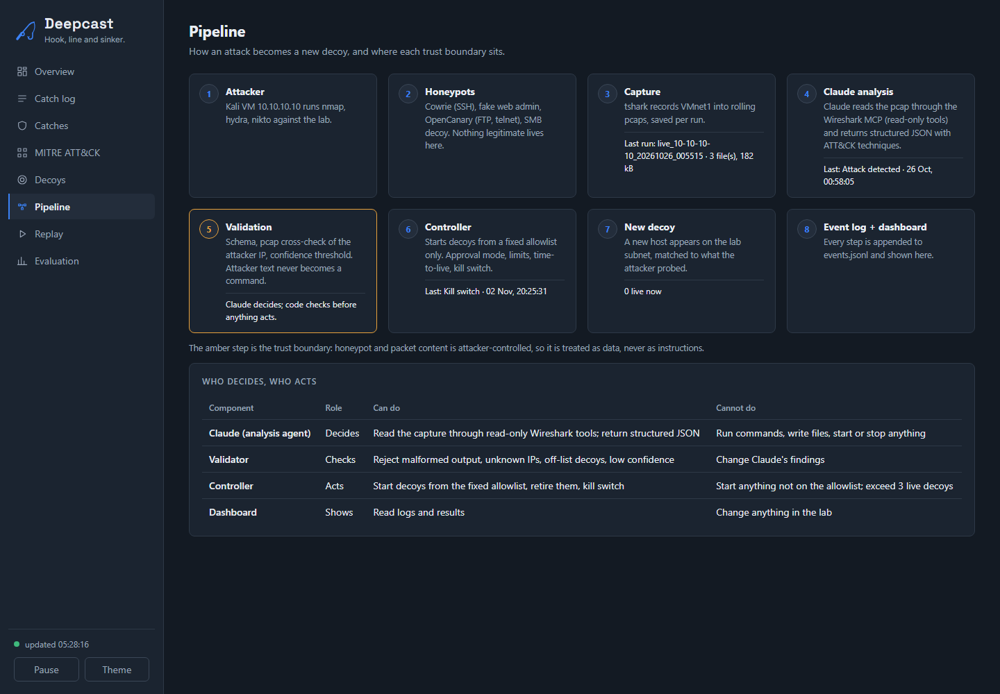
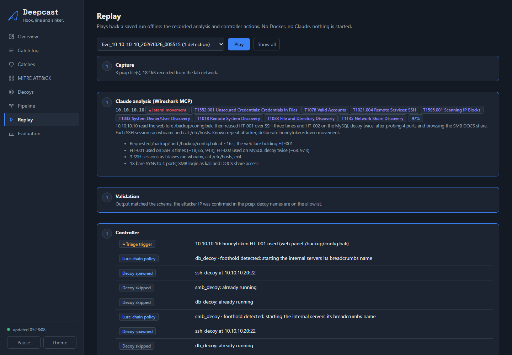
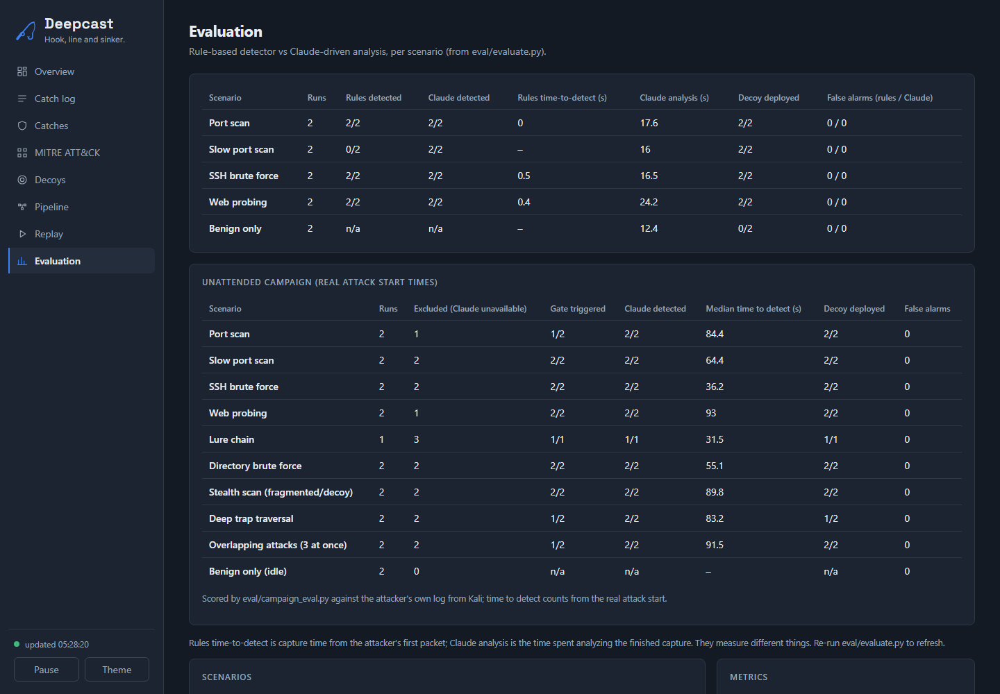

<p align="center">
  
</p>

# Deepcast

**An AI-driven adaptive deception platform.** Honeypots act as traps. An AI analyst (Claude) reads the captured network traffic and works out what an attacker is after. A separate controller then starts matching decoys, so the attacker's next step leads somewhere new. Everything is logged, shown on a live dashboard and written up as an incident report.

*Hook, line and sinker.*

> Defensive research project. Everything runs in an isolated, host-only lab network against the author's own attacker VM. No malware or exploit code is included; attack tooling is standard (nmap, hydra, nikto, gobuster, curl, ssh, smbclient).

---

## The problem

Attackers scan, guess passwords and hunt for credentials. Classic defenses mostly wait for an alert on something that already happened, and static honeypots just sit there: they never change to match what the attacker is looking for.

Deception flips that. Nothing legitimate ever touches a trap, so any contact is a high-confidence signal. Deepcast goes one step further and makes the traps **adaptive**: it reads what the attacker is doing and puts the next thing they are looking for in their path.

## See it

The live dashboard (read-only, runs locally) shows every step as it happens.

| | |
|---|---|
| <br>**Overview**: runs analyzed, attackers caught, decoys spawned, latest detections | <br>**Catch log**: every platform action, grouped by incident |
| <br>**Catches**: one card per attacker, with ATT&CK techniques, evidence and severity | <br>**MITRE ATT&CK**: observed techniques under their tactics |
| <br>**Decoys**: what the controller started and why | <br>**Pipeline**: who decides, who acts, where trust boundaries sit |
| <br>**Replay**: play back recorded attacks offline | <br>**Evaluation**: rule baseline vs Claude, scored per scenario |

## What it does, in one picture

```
 KALI VM (attacker)                       WINDOWS HOST  10.10.10.1
 10.10.10.10   ───────────────────────►   (VMware VMnet1, host-only, 10.10.10.0/24, never bridged)
 nmap · hydra · nikto                      │
                                           ├─ Docker: honeypots on published ports
 WORKSTATION VM (benign)                   │     Cowrie SSH :2222 · fake web admin :8080
 10.10.10.30  ──── normal traffic ───────► │     OpenCanary FTP/Telnet · SMB decoy :4445
 page loads · admin SSH · DNS · pings      │
 logs its own ground truth                 ├─ tshark ─► rolling 30 s captures of VMnet1
                                           │              │
                                           │              ├─► detect/stream.py   rules, per packet  (~1 s)
                                           │              └─► agent/watcher.py   triage gate ─► incident
                                           │                                          │
                                           │                         agent/analyze.py │ headless Claude +
                                           │                         read-only Wireshark MCP tools
                                           │                                          ▼
                                           │                      validated JSON: attacker IP, stage,
                                           │                      MITRE ATT&CK, evidence, confidence,
                                           │                      recommended decoys
                                           │                                          ▼
                                           ├─ controller/controller.py   checks the JSON against a fixed
                                           │      allowlist, then starts / retires decoy containers
                                           │
                                           └─ lab/logs/events.jsonl (append-only)
                                                  ├─► dashboard (Flask, read-only)
                                                  └─► HTML + PDF incident report per incident
```

## How it works

1. **Trap.** The attacker scans and probes the lab. The honeypots answer like real services (an SSH server that looks lived-in, an Apache-style admin panel, FTP, Telnet, an SMB file share) and record every move.
2. **Capture.** tshark records the lab network in rolling 30-second windows. The pcap is the source of truth for who the attacker really is, because Docker hides the real source address in the honeypot logs.
3. **Triage.** A cheap gate (many distinct ports, many SSH connections, many HTTP requests, or a planted credential used) opens an incident for that source. It only decides *when to wake the analyst*, never what is true.
4. **Analyze.** Headless Claude reads the capture through **read-only Wireshark MCP tools**, plus honeypot logs and what the attacker typed. It returns structured JSON: attacker IP, stage, MITRE ATT&CK techniques, evidence with real numbers, confidence, and which decoys to deploy.
5. **Validate and act.** The output is checked against a JSON schema and cross-checked with the pcap (the attacker address must really appear in it). Then a separate **controller**, the only thing allowed to act, starts decoys from a **fixed allowlist** of five templates, with confidence, count and lifetime limits.
6. **Record.** Every step goes to an append-only event log that feeds the dashboard and a per-incident report (summary, merged timeline, attacker profile, proof recomputed from the pcap, ATT&CK table, response taken, recommendations, indicators, SHA-256 of the evidence).

### Claude decides, the controller acts

The AI never runs commands. It returns JSON and names a decoy *template*; the controller owns the image, ports and resource limits and rejects anything off the list. There is a confidence floor (0.5), at most 3 live decoys, a 30-minute lifetime, an optional human-approval mode and a kill switch that removes every spawned decoy. Text typed by an attacker is treated as untrusted data and cannot instruct the analyst (tested with planted prompt injections).

### Two speeds

| Path | Trigger | Reaction time | AI involved |
|---|---|---|---|
| **Fast path** | A planted fake credential (honeytoken) is used, or a lure file is read | decoys up in about **1 second** | No: fixed policy from the allowlist |
| **Claude path** | Triage gate opens an incident | about **30-60 seconds** | Yes: deep analysis, ATT&CK mapping, report |

Rules are fast but only see what they were written for. Claude is slower but understands context and explains it. Deepcast uses both.

### Honeytokens and the lure chain

A honeytoken is a fake credential planted as bait. Nobody legitimate holds it, so using it is near-proof that someone read the lure and acted on it.

```
robots.txt ─► /backup/ ─► config.bak ─► SSH login (token HT-001) ─► server's hosts file
   ─► "db-prod-01" ─► SMB share note (token HT-002) ─► database login on the decoy
```

Using the SSH token triggers the fast path, which starts the database and file-server decoys named in the breadcrumbs *before* the attacker follows them, so the servers are there when they go looking. Incidents that touch a honeytoken, or a decoy reachable only through a lure, are rated **Critical**.

### AI-assisted detection learning

When the hand-written rules miss an attack, Claude is shown only **numbers** about it (never attacker-typed text) and proposes one new detection rule in a small declarative format with no code. A **promotion gate** replays the proposal over recorded benign and attack traffic and only accepts it if it catches the attack with no false alarms; a deliberately noisy rule is rejected, and any promoted rule can be rolled back.

## Results

Unattended campaigns from Kali against the live platform, with the benign workstation running normal traffic the whole time. Nine attack types: port scan, slow scan, SSH brute force, web probing, directory brute force, stealth scan (fragmented probes with spoofed decoy sources), lure chain, deep trap traversal, and overlapping attacks.

- **Every attack type detected and a decoy deployed.** Median time to detect: port scan 34 s, SSH brute force 51 s, web probing 95 s, lure chain 43 s, stealth scan 32 s (full table: [`eval/results/campaign_postfix_2026-10-24.md`](eval/results/campaign_postfix_2026-10-24.md)).
- **Zero detections or decoys naming the benign workstation** across about 2 hours of live runs, including a 25-minute idle window.
- **Honeytoken fast path:** decoys up 0.6-1.4 s after the credential is used.
- **Detection learning:** the baseline rules miss the lure chain (0/15), stealth scan (0/7) and deep traversal (0/7); with the learned rules they are caught 15/15, 7/7 and 7/7, with **0 false alarms** over 389 minutes of benign traffic ([`detect/results.md`](detect/results.md)).
- **Rules vs Claude:** fixed-threshold rules react in about 1 s on loud attacks but never see the lure chain, stealth scan or traversal. The lesson: use both, rules for speed and the LLM for judgement and explanation.

Claims are worded as "on the tested dataset": samples are small (2+ runs per type), there is one attacker host in one lab, and Claude's output varies between runs. Full method and limits: [`eval/README.md`](eval/README.md).

## Testing found real flaws

Testing harder than the happy path broke the platform several times; each was measured, fixed and re-proven. Examples: with two attackers at once the fast path was 30 s late (now 1 s); the benign workstation was once blamed for the attacker's honeytoken use; a single `find /` froze the SSH honeypot. See [docs/LESSONS.md](docs/LESSONS.md).

## Repository map

| Folder | What is in it |
|---|---|
| [`lab/`](lab) | Docker Compose lab, honeypot configs, lure and breadcrumb generators ([trap map](lab/TRAPS.md)) |
| [`capture/`](capture) | tshark capture and run-saving scripts |
| [`agent/`](agent) | The AI analyst: prompt, schema, watcher, attribution, severity ([output format](agent/README.md)) |
| [`controller/`](controller) | Allowlist and the spawn / retire logic |
| [`detect/`](detect) | Streaming rule engine, rule format, learning loop and promotion gate ([details](detect/README.md)) |
| [`traffic/`](traffic) | Benign traffic generator and its ground-truth log |
| [`dashboard/`](dashboard) | Live read-only web dashboard |
| [`report/`](report) | Incident report generator (HTML + PDF) |
| [`eval/`](eval) | Campaign runner, scoring, rule-based baseline, results ([method](eval/README.md)) |
| [`attacks/`](attacks) | Lab-only attack scenarios run from the attacker VM ([scenarios](attacks/README.md)) |
| [`corpus/`](corpus) | Manifest of the labeled replay corpus (labels, splits, pcap hashes) |
| [`replays/`](replays) | Three small recorded runs (pcap + saved Claude output) for offline replay |
| [`scripts/`](scripts) | One-command helpers: self-tests, manual run loop, offline replay |
| [`docs/`](docs) | [Code map](docs/CODE_MAP.md), [running guide](docs/RUNNING.md), [lessons learned](docs/LESSONS.md) |

**What each script does:** [docs/CODE_MAP.md](docs/CODE_MAP.md).

## Try it

Full setup (VMware network, Docker, Wireshark MCP) is in [docs/RUNNING.md](docs/RUNNING.md). The short version:

```bash
cp .env.example .env          # lab addresses, ports, capture interface
bash lab/up.sh                # honeypots start with one command
python agent/watcher.py       # continuous monitoring: capture, triage, Claude, controller
python dashboard/app.py       # http://127.0.0.1:5000
bash scripts/tests.sh                 # self-tests, no lab needed
```

No lab at hand? The bundled recordings replay offline, with or without Claude:

```bash
bash scripts/replay.sh level2 sshbrute_demo     # saved Claude output -> validation -> controller (offline)
bash scripts/replay.sh level1 sshbrute_demo     # re-analyze the bundled pcap with Claude
```

## Stack

Python, Docker Compose, Cowrie, OpenCanary, Impacket, Flask, tshark and the Wireshark MCP server, Claude (headless Claude Code), MITRE ATT&CK, JSON-lines logs. Lab on VMware with a Kali attacker VM.

## Safety and limits

Lab only, isolated host-only network, own attacker VM, own targets. Not a product: it is a transparent reference implementation of one design question, whether an LLM can act as the analyst in an adaptive-deception loop safely and measurably. Honest limits: small samples, one lab, and an attacker who logs in with a legitimate account and runs only ordinary commands is harder to catch.
